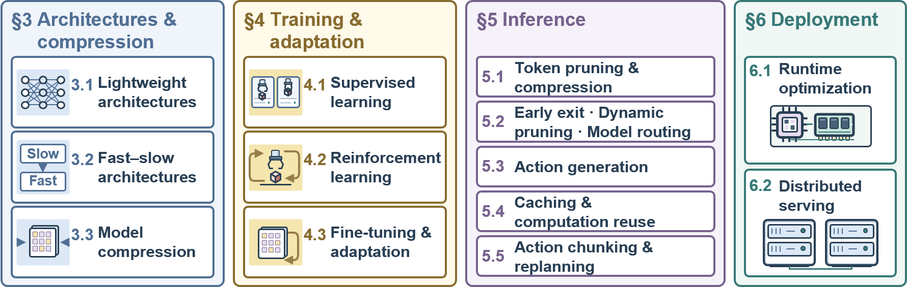
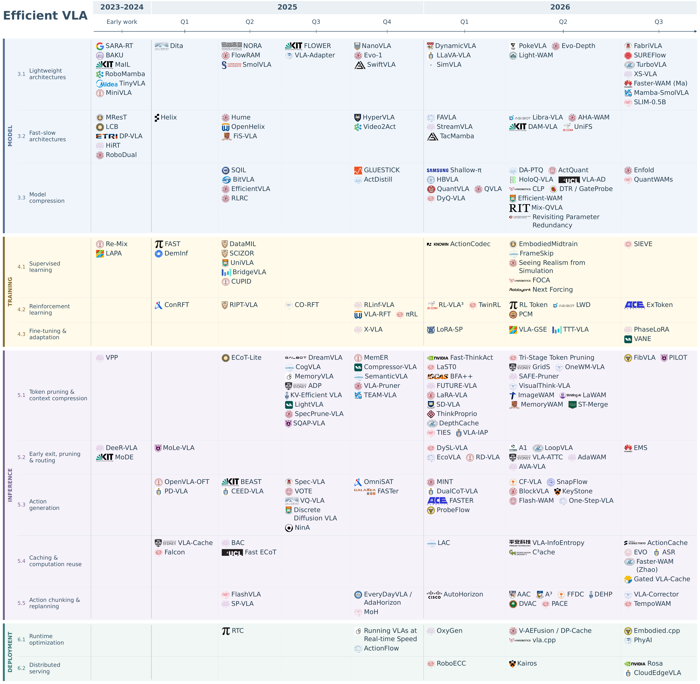

# Awesome-Efficient-VLA [](https://awesome.re)

[](https://arxiv.org/pdf/2510.17111)
[](https://github.com/guanweifan/awesome-efficient-vla/commits/main/)
[](https://github.com/guanweifan/awesome-efficient-vla/pulls)
[](https://github.com/guanweifan/efficient-vla-benchmark)

<p align="center">
  
</p>

📖 **Survey:** A curated collection of efficient VLA research accompanying [our survey](https://arxiv.org/pdf/2510.17111).<br>
🚀 **Benchmark:** Explore implementations and evaluations in [Efficient VLA Benchmark](https://github.com/guanweifan/efficient-vla-benchmark).

[Papers](#complete-paper-list) · [Timeline](#timeline) · [Related Surveys](#related-surveys) · [Citation](#citation)

## Paper Index

**208 papers** · 13 categories · First public release through 17 August 2026

**3. Efficient Architectures and Model Compression**&nbsp;·&nbsp;68&nbsp;papers<br>
[3.1 Lightweight Architectures](#lightweight-architectures)&nbsp;(28) · [3.2 Fast–Slow Architectures](#fast-slow-architectures)&nbsp;(18) · [3.3 Model Compression](#model-compression)&nbsp;(22)

**4. Efficient Training and Adaptation**&nbsp;·&nbsp;34&nbsp;papers<br>
[4.1 Efficient Supervised Learning](#efficient-supervised-learning)&nbsp;(16) · [4.2 Efficient Reinforcement Learning](#efficient-reinforcement-learning)&nbsp;(12) · [4.3 Efficient Fine-Tuning and Adaptation](#efficient-fine-tuning-and-adaptation)&nbsp;(6)

**5. Efficient Inference**&nbsp;·&nbsp;94&nbsp;papers<br>
[5.1 Token Pruning and Context Compression](#token-pruning-and-context-compression)&nbsp;(36) · [5.2 Early Exit, Dynamic Pruning, and Model Routing](#early-exit-dynamic-pruning-and-model-routing)&nbsp;(12) · [5.3 Efficient Action Generation](#efficient-action-generation)&nbsp;(21) · [5.4 Caching and Computation Reuse](#caching-and-computation-reuse)&nbsp;(12) · [5.5 Action Chunking and Replanning](#action-chunking-and-replanning)&nbsp;(13)

**6. Efficient Deployment**&nbsp;·&nbsp;12&nbsp;papers<br>
[6.1 Runtime Optimization](#runtime-optimization)&nbsp;(8) · [6.2 Distributed Serving](#distributed-serving)&nbsp;(4)

## Timeline

[](./imgs/timeline.png)

## Complete Paper List

Each work appears once under its primary contribution. `Sec.` marks secondary relevance; `Code` and `Venue` provide repository and publication information where available. Entries are ordered by first public release, newest first.

## 3. Efficient Architectures and Model Compression

Reduce model cost through lightweight architectures, fast–slow coordination, pruning, quantization, and distillation.

<a id="lightweight-architectures"></a>
### 3.1 Lightweight Architectures

- [**Faster-WAM: Do World Action Models Need Deep Action Modules? (Faster-WAM, Ma et al.)**](https://arxiv.org/pdf/2608.02365) · `2026-08` · Single-layer action head docked onto multi-level video-Transformer representations.
- [**Mamba-based Selective State Space Modeling Improves the Accuracy-Complexity Tradeoff of SmolVLA Vision-Language-Action Experts (Mamba-SmolVLA)**](https://arxiv.org/pdf/2608.21407) · `2026-08` · Mamba replaces causal self-attention in the SmolVLA action expert while retaining cross-attention conditioning.
- [**SLIM-0.5B: Learning Action-Grounded Predictive Latents for Robot Manipulation**](https://arxiv.org/pdf/2608.09771) · `2026-08` · Compact latent-interaction policy learning action-grounded predictive representations through masked trajectory prediction.
- [**FabriVLA: A Lightweight Vision-Language-Action Model with Conformal Action Chunk Uncertainty**](https://arxiv.org/pdf/2607.08575) · `2026-07` · Compact flow policy fusing shallow and intermediate VLM features, with post-training action-chunk uncertainty calibration.
- [**SUREFlow: State-space Uncertainty-aware REsidual Flow Matching for Robust Robot Manipulation**](https://arxiv.org/pdf/2607.10504) · `2026-07` · Mamba-based multimodal fusion with uncertainty-aware residual flow refinement for robot actions. <sub>[Code](https://github.com/tanvirnwu/SUREFlow)</sub>
- [**TurboVLA: Real-Time Vision-Language-Action Model at 32 Hz on an RTX 4090 with &lt;1 GB VRAM**](https://arxiv.org/pdf/2607.27205) · `2026-07` · Compact direct vision-language-to-action pathway with a 0.2B policy and single-pass action decoding. <sub>[Code](https://github.com/H-EmbodVis/TurboVLA)</sub>
- [**Teaching Tiny VLA Models Where to Look and How to Move (XS-VLA)**](https://arxiv.org/pdf/2607.04171) · `2026-07` · Spatial distillation and latent flow matching strengthen a tiny VLA without deploying its teacher.
- [**Light-WAM: Efficient World Action Models with State-Fusion Action Decoding**](https://arxiv.org/pdf/2606.08242) · `2026-06` · Single-forward StateFusionActionExpert with a compact video backbone for efficient WAM action decoding. <sub>[Code](https://github.com/L1ziang/Light-WAM)</sub>
- [**Evo-Depth: A Lightweight Depth-Enhanced Vision-Language-Action Model**](https://arxiv.org/pdf/2605.14950) · `2026-05` · Lightweight implicit depth encoding from RGB inputs with depth-aware modulation of vision-language features. <sub>[Code](https://github.com/MINT-SJTU/Evo-Depth)</sub>
- [**PokeVLA: Empowering Pocket-Sized Vision-Language-Action Model with Comprehensive World Knowledge Guidance**](https://arxiv.org/pdf/2604.20834) · `2026-04` · Pocket-sized VLA with a lightweight embodied-aware VLM and spatial-semantic guidance.
- [**Rethinking the Practicality of Vision-language-action Model: A Comprehensive Benchmark and An Improved Baseline (LLaVA-VLA)**](https://arxiv.org/pdf/2602.22663) · `2026-02` · Lightweight VLA baseline evaluated in a cross-embodiment benchmark focused on practical deployment. <sub>[Code](https://github.com/OpenHelix-Team/LLaVA-VLA)</sub>
- [**SimVLA: A Simple VLA Baseline for Robotic Manipulation**](https://arxiv.org/pdf/2602.18224) · `2026-02` · Streamlined VLA with a compact vision-language backbone and lightweight action head. <sub>[Code](https://github.com/LUOyk1999/SimVLA)</sub>
- [**DynamicVLA: A Vision-Language-Action Model for Dynamic Object Manipulation**](https://arxiv.org/pdf/2601.22153) · `2026-01` · Latent-aware action streaming. <sub>[Code](https://github.com/hzxie/DynamicVLA)</sub>
- [**SwiftVLA: Unlocking Spatiotemporal Dynamics for Lightweight VLA Models at Minimal Overhead**](https://arxiv.org/pdf/2512.00903) · `2025-12` · Lightweight VLA learns spatiotemporal representations from a training-time 4D branch that is removed at inference. <sub>[Code](https://github.com/GigaAI-research/SwiftVLA)</sub>
- [**Evo-1: Lightweight Vision-Language-Action Model with Preserved Semantic Alignment**](https://arxiv.org/pdf/2511.04555) · `2025-11` · Compact multimodal backbone with a cross-modulated diffusion transformer. <sub>[Code](https://github.com/MINT-SJTU/Evo-1)</sub>
- [**NANOVLA: ROUTING DECOUPLED VISION-LANGUAGE UNDERSTANDING FOR NANO-SIZED GENERALIST ROBOTIC POLICIES**](https://arxiv.org/pdf/2510.25122) · `2025-10` · Lightweight VLA with dynamic routing. <sub>Sec. 5.2</sub>
- [**FLOWER: Democratizing Generalist Robot Policies with Efficient Vision-Language-Action Flow Policies**](https://arxiv.org/pdf/2509.04996) · `2025-09` · Intermediate-modality fusion with LLM layer pruning. <sub>[Code](https://github.com/intuitive-robots/flower_vla_calvin) · Venue: CoRL 2025</sub>
- [**VLA-Adapter: An Effective Paradigm for Tiny-Scale Vision-Language-Action Model**](https://arxiv.org/pdf/2509.09372) · `2025-09` · Bridge Attention connects multi-layer vision-language features to a lightweight policy module. <sub>[Code](https://github.com/OpenHelix-Team/VLA-Adapter) · Sec. 4.3</sub>
- [**FlowRAM: Grounding Flow Matching Policy with Region-Aware Mamba Framework for Robotic Manipulation**](https://arxiv.org/pdf/2506.16201) · `2025-06` · Region-aware geometric processing and Mamba fusion paired with a flow-matching action policy.
- [**SmolVLA: A vision-language-action model for affordable and efficient robotics**](https://arxiv.org/pdf/2506.01844) · `2025-06` · Single-GPU training with asynchronous inference. <sub>[Code](https://github.com/huggingface/lerobot) · Sec. 6.1</sub>
- [**NORA: A SMALL OPEN-SOURCED GENERALIST VISION-LANGUAGE ACTION MODEL FOR EMBODIED TASKS**](https://arxiv.org/pdf/2504.19854) · `2025-04` · Qwen-2.5-VL-3B backbone with a FAST+ tokenizer. <sub>[Code](https://github.com/declare-lab/nora)</sub>
- [**Dita: Scaling Diffusion Transformer for Generalist Vision-Language-Action Policy**](https://arxiv.org/pdf/2503.19757) · `2025-03` · Language-conditioned visual encoding with a diffusion Transformer for continuous action sequences. <sub>[Code](https://github.com/RoboDita/Dita)</sub>
- [**MiniVLA: A Better VLA with a Smaller Footprint**](https://ai.stanford.edu/blog/minivla/) · `2024-12` · Compact OpenVLA variant with vector-quantized action chunks and multi-image inputs. <sub>[Code](https://github.com/Stanford-ILIAD/openvla-mini)</sub>
- [**TinyVLA: Towards Fast, Data-Efficient Vision-Language-Action Models for Robotic Manipulation**](https://arxiv.org/pdf/2409.12514) · `2024-09` · High-speed multimodal backbone with a diffusion policy decoder. <sub>[Code](https://github.com/liyaxuanliyaxuan/TinyVLA) · Venue: RAL 2025</sub>
- [**BAKU: An Efficient Transformer for Multi-Task Policy Learning**](https://arxiv.org/pdf/2406.07539) · `2024-06` · Transformer policy combining observation encoders, action chunking, and lightweight action heads for multi-task imitation learning. <sub>[Code](https://github.com/siddhanthaldar/BAKU)</sub>
- [**MaIL: Improving Imitation Learning with Mamba**](https://arxiv.org/pdf/2406.08234) · `2024-06` · Mamba-based imitation-learning policies for data-efficient multi-task robot control. <sub>[Code](https://github.com/ALRhub/MaIL)</sub>
- [**RoboMamba: Efficient Vision-Language-Action Model for Robotic Reasoning and Manipulation**](https://arxiv.org/pdf/2406.04339) · `2024-06` · Mamba state-space backbone for linear-complexity reasoning and efficient inference. <sub>[Code](https://github.com/lmzpai/roboMamba) · Venue: NeurIPS 2024</sub>
- [**SARA-RT: Scaling up Robotics Transformers with Self-Adaptive Robust Attention**](https://arxiv.org/pdf/2312.01990) · `2023-12` · Up-training converts pretrained robotics Transformers into linear-attention policies.

<a id="fast-slow-architectures"></a>
### 3.2 Fast–Slow Architectures

- [**AHA-WAM: Asynchronous Horizon-Adaptive World-Action Modeling with Observation-Guided Context Routing**](https://arxiv.org/pdf/2606.09811) · `2026-06` · Low-frequency world planner with reusable rolling KV context and a high-frequency action executor. <sub>[Code](https://github.com/serene-sivy/AHA-WAM)</sub>
- [**DAM-VLA: Decoupled Asynchronous Multimodal Vision Language Action Model**](https://arxiv.org/pdf/2606.12105) · `2026-06` · Per-modality latent buffers refreshed at native sensor rates for high-frequency action control.
- [**UniFS: Unified Fast-to-Slow Hierarchical Architecture for Vision-Language-Action Models**](https://arxiv.org/pdf/2606.22794) · `2026-06` · Fast-to-slow VLM layer groups with multi-frequency latent routing to the action expert. <sub>[Code](https://github.com/linsun449/UniFS)</sub>
- [**Libra-VLA: Achieving Learning Equilibrium via Asynchronous Coarse-to-Fine Dual-System**](https://arxiv.org/pdf/2604.24921) · `2026-04` · Asynchronous coarse-to-fine coordination between a semantic planner and continuous-action refiner.
- [**TacMamba: A Tactile History Compression Adapter Bridging Fast Reflexes and Slow VLA Reasoning**](https://arxiv.org/pdf/2603.01700) · `2026-03` · Tactile history compression for high-frequency tactile control.
- [**FAVLA: A Force-Adaptive Fast-Slow VLA model for Contact-Rich Robotic Manipulation**](https://arxiv.org/pdf/2602.23648) · `2026-02` · Slow visual-language guidance with force-conditioned fast control and adaptive action-expert updates.
- [**StreamVLA: Breaking the Reason-Act Cycle via Completion-State Gating**](https://arxiv.org/pdf/2602.01100) · `2026-02` · Lock-and-gated selective slow reasoning.
- [**Video2Act: A Dual-System Video Diffusion Policy with Robotic Spatio-Motional Modeling**](https://arxiv.org/pdf/2512.03044) · `2025-12` · Dual-system VLA with slow VDM reasoning. <sub>[Code](https://github.com/jiayueru/Video2Act)</sub>
- [**HyperVLA: Efficient Inference in Vision-Language-Action Models via Hypernetworks**](https://arxiv.org/pdf/2510.04898) · `2025-10` · A hypernetwork generates a compact task-specific controller from episode context. <sub>[Code](https://github.com/MasterXiong/Hyper-VLA)</sub>
- [**Fast-in-Slow: A Dual-System Foundation Model Unifying Fast Manipulation within Slow Reasoning (FiS-VLA)**](https://arxiv.org/pdf/2506.01953) · `2025-06` · Fast execution module inside a VLM-based reasoning model. <sub>[Code](https://github.com/CHEN-H01/Fast-in-Slow) · Venue: NeurIPS 2025</sub>
- [**Hume: Introducing System-2 Thinking in Visual-Language-Action Model**](https://arxiv.org/pdf/2505.21432) · `2025-05` · Value-guided slow thinking with lightweight reactive action denoising. <sub>[Code](https://github.com/hume-vla/hume)</sub>
- [**OPENHELIX: A Short Survey, Empirical Analysis, and Open-Source Dual-System VLA Model for Robotic Manipulation**](https://arxiv.org/pdf/2505.03912) · `2025-05` · Systematic structural evaluation with a low-cost design. <sub>[Code](https://github.com/OpenHelix-Team/OpenHelix)</sub>
- [**Helix: A Vision-Language-Action Model for Generalist Humanoid Control**](https://www.figure.ai/news/helix) · `2025-02` · System 2 vision-language reasoning guides a fast System 1 policy for humanoid upper-body control.
- [**A Dual Process VLA: Efficient Robotic Manipulation Leveraging VLM (DP-VLA)**](https://arxiv.org/pdf/2410.15549) · `2024-10` · Low-frequency VLM reasoning guides a small, high-frequency motor-control policy.
- [**HiRT: Enhancing Robotic Control with Hierarchical Robot Transformers**](https://arxiv.org/pdf/2410.05273) · `2024-10` · Low-frequency VLM reasoning with high-frequency vision-based control. <sub>Venue: CoRL 2024</sub>
- [**TOWARDS SYNERGISTIC, GENERALIZED AND EFFICIENT DUAL-SYSTEM FOR ROBOTIC MANIPULATION (RoboDual)**](https://arxiv.org/pdf/2410.08001) · `2024-10` · Generalist reasoning with a lightweight specialist diffusion policy.
- [**From LLMs to Actions: Latent Codes as Bridges in Hierarchical Robot Control (LCB)**](https://arxiv.org/pdf/2405.04798) · `2024-05` · Learnable latent codes connect high-level language planning to low-level robot policies.
- [**MResT: Multi-Resolution Sensing for Real-Time Control with Vision-Language Models**](https://arxiv.org/pdf/2401.14502) · `2024-01` · Multi-resolution sensing combines low-frequency global semantics with fast local visual and force feedback.

<a id="model-compression"></a>
### 3.3 Model Compression

- [**Enfold: Folding World Model Imagination into Predictive Representations for Ultra-Efficient Embodied Control**](https://arxiv.org/pdf/2607.26657) · `2026-07` · Distills world-generator states into current-only predictive control representations. <sub>[Code](https://github.com/zwl666666/enfold)</sub>
- [**QuantWAMs: Calibrating at the Right Granularity for World Action Models**](https://arxiv.org/pdf/2607.28405) · `2026-07` · Rollout-aware mixed-precision PTQ for video and action blocks in WAMs.
- [**Finetuning Vision-Language-Action Models Requires Fewer Layers Than You Think (CLP)**](https://arxiv.org/pdf/2606.20246) · `2026-06` · CKA-guided layer pruning before downstream VLA fine-tuning.
- [**Drop-Then-Recovery: How Redundant Are Vision-Language-Action Models? (DTR / GateProbe)**](https://arxiv.org/pdf/2606.27755) · `2026-06` · Transformer block removal and GateProbe sensitivity ranking for recoverable VLA pruning. <sub>[Code](https://github.com/s1ghhh/VLADrop)</sub>
- [**Efficient-WAM: A 1B-Parameter World-Action Model with Low-Cost Future Imagination**](https://arxiv.org/pdf/2606.10040) · `2026-06` · Compact video expert with token-sparse future latents and asymmetric video-action denoising. <sub>[Code](https://github.com/jiajun613/Efficient-WAM) · Sec. 5.1; 5.3</sub>
- [**Mix-QVLA: Task-Evidence-Aware Mixed-Precision Quantization of Vision-Language-Action Models**](https://arxiv.org/pdf/2606.19565) · `2026-06` · Task-evidence- and time-aware mixed-precision quantization for VLA memory and BitOps reduction.
- [**Revisiting Parameter Redundancy in Vision-Language-Action Models: Insights from VLM-to-VLA Adaptation (VLM2VLA Parameter Redundancy)**](https://arxiv.org/pdf/2606.31382) · `2026-06` · VLM-to-VLA adaptation divergence guides multi-module parameter pruning without post-pruning recovery. <sub>[Code](https://github.com/Niannnnnn/VLA_Parameter_Redundancy_VLM2VLA)</sub>
- [**ActQuant: Sub-4-bit Action-Guided Quantization for Vision-Language-Action Models**](https://arxiv.org/pdf/2605.24011) · `2026-05` · Action-guided mixed-precision PTQ for sub-4-bit VLA compression and edge deployment. <sub>[Code](https://github.com/arashakb/ActQuant)</sub>
- [**HoloQ-VLA: Uniform W4A4 Quantization of Vision-Language-Action Models (also known as Ω-QVLA)**](https://arxiv.org/pdf/2605.28803) · `2026-05` · Training-free W4A4 quantization for both the VLA language backbone and diffusion action head. <sub>[Code](https://github.com/UCMP13753/Omega-QVLA)</sub>
- [**Offline Semantic Guidance for Efficient Vision-Language-Action Policy Distillation (VLA-AD)**](https://arxiv.org/pdf/2605.16241) · `2026-05` · Offline VLM semantic guidance for distilling large VLA teachers into compact students.
- [**DA-PTQ: Drift-Aware Post-Training Quantization for Efficient Vision-Language-Action Models**](https://arxiv.org/pdf/2604.11572) · `2026-04` · Drift-aware PTQ with cross-space compensation and mixed precision.
- [**DyQ-VLA: Temporal-Dynamic-Aware Quantization for Embodied Vision-Language-Action Models**](https://arxiv.org/pdf/2603.07904) · `2026-03` · Dynamic quantization using kinematic sensitivity.
- [**HBVLA: Pushing 1-Bit Post-Training Quantization for Vision-Language-Action Models**](https://arxiv.org/pdf/2602.13710) · `2026-02` · Hessian-guided 1-bit binarization.
- [**QuantVLA: Scale-Calibrated Post-Training Quantization for Vision-Language-Action Models**](https://arxiv.org/pdf/2602.20309) · `2026-02` · Scale-calibrated PTQ for low-bit deployment. <sub>[Code](https://github.com/AIoT-MLSys-Lab/QuantVLA)</sub>
- [**QVLA: Not All Channels Are Equal in Vision-Language-Action Model's Quantization**](https://arxiv.org/pdf/2602.03782) · `2026-02` · Channel-wise mixed-bit quantization. <sub>[Code](https://github.com/AutoLab-SAI-SJTU/QVLA) · Venue: ICLR 2026</sub>
- [**Shallow-π: Knowledge Distillation for Flow-based VLAs**](https://arxiv.org/pdf/2601.20262) · `2026-01` · Knowledge distillation for reduced-depth flow-based VLA models.
- [**ActDistill: General Action-Guided Self-Derived Distillation for Efficient Vision-Language-Action Models**](https://arxiv.org/pdf/2511.18082) · `2025-11` · Action-guided distillation with a dynamically routed student. <sub>[Code](https://github.com/gooogleshanghai/ActDistill) · Sec. 5.2</sub>
- [**Don’t Run with Scissors: Pruning Breaks VLA Models but They Can Be Recovered (GLUESTICK)**](https://arxiv.org/pdf/2510.08464) · `2025-10` · Recovery for pruned VLA models.
- [**BitVLA: 1-bit Vision-Language-Action Models for Robotics Manipulation**](https://arxiv.org/pdf/2506.07530) · `2025-06` · Distillation-aware low-bit compression. <sub>[Code](https://github.com/ustcwhy/BitVLA)</sub>
- [**EfficientVLA: Training-Free Acceleration and Compression for Vision-Language-Action Models**](https://www.arxiv.org/pdf/2506.10100) · `2025-06` · Layer pruning, visual token selection, and temporal reuse. <sub>Venue: NeurIPS 2025 · Sec. 5.1; 5.4</sub>
- [**RLRC: Reinforcement Learning-based Recovery for Compressed Vision-Language-Action Models**](https://arxiv.org/pdf/2506.17639) · `2025-06` · Structured pruning followed by supervised and reinforcement-learning recovery, then quantization.
- [**Saliency-Aware Quantized Imitation Learning for Efficient Robotic Control (SQIL)**](https://arxiv.org/pdf/2505.15304) · `2025-05` · Quantization-aware imitation learning emphasizes saliency-identified critical states during action distillation.

## 4. Efficient Training and Adaptation

Improve the efficiency of supervision, reinforcement learning, and policy adaptation.

<a id="efficient-supervised-learning"></a>
### 4.1 Efficient Supervised Learning

- [**SIEVE: Structure-Aware Data Selection for Imitation Learning with VLA Models**](https://arxiv.org/pdf/2607.06442) · `2026-07` · Primitive- and transition-aware selection of compact, representative imitation-learning subsets. <sub>[Code](https://github.com/ChangtiWu/SIEVE)</sub>
- [**FOCA: Future-Oriented Conditioning for Data-Efficient Vision-Language-Action Adaptation**](https://arxiv.org/pdf/2606.20867) · `2026-06` · Future interaction embeddings and latent future-goal alignment for few-shot VLA adaptation. <sub>[Code](https://github.com/cair-vinuni/FOCA)</sub>
- [**Next Forcing: Causal World Modeling with Multi-Chunk Prediction**](https://arxiv.org/pdf/2606.11187) · `2026-06` · Multi-chunk future prediction modules provide dense causal supervision and parallel future-chunk inference. <sub>[Code](https://github.com/gangweix/next-forcing)</sub>
- [**FrameSkip: Learning from Fewer but More Informative Frames in VLA Training**](https://arxiv.org/pdf/2605.13757) · `2026-05` · Informative-frame selection for reducing temporal supervision redundancy. <sub>[Code](https://github.com/ZGC-EmbodyAI/FrameSkip)</sub>
- [**Seeing Realism from Simulation: Efficient Video Transfer for Vision-Language-Action Data Augmentation**](https://arxiv.org/pdf/2605.02757) · `2026-05` · Velocity-cached video transfer plus coreset sampling for efficient data augmentation. <sub>[Code](https://github.com/nanfangxiansheng/Seeing-Realism-from-Simulation)</sub>
- [**EmbodiedMidtrain: Bridging the Gap between Vision-Language Models and Vision-Language-Action Models via Mid-training**](https://arxiv.org/pdf/2604.20012) · `2026-04` · VLA-aligned vision-language data selection and mid-training prepare backbones for downstream robot learning.
- [**ActionCodec: What Makes for Good Action Tokenizers**](https://arxiv.org/pdf/2602.15397) · `2026-02` · Optimization-oriented action tokenizer. <sub>Sec. 5.3</sub>
- [**BridgeVLA: Input-Output Alignment for Efficient 3D Manipulation Learning with Vision-Language Models**](https://arxiv.org/pdf/2506.07961) · `2025-06` · Aligned multi-view image inputs and action heatmaps improve data-efficient 3D manipulation learning.
- [**CUPID: Curating Data your Robot Loves with Influence Functions**](https://arxiv.org/pdf/2506.19121) · `2025-06` · Influence-based demonstration selection estimates contributions to closed-loop policy returns. <sub>[Code](https://github.com/agiachris/cupid)</sub>
- [**DataMIL: Selecting Data for Robot Imitation Learning with Datamodels**](https://arxiv.org/pdf/2505.09603) · `2025-05` · Datamodel-based selection uses target-task proxy losses to curate robot imitation-learning data.
- [**SCIZOR: A Self-Supervised Approach to Data Curation for Large-Scale Imitation Learning**](https://arxiv.org/pdf/2505.22626) · `2025-05` · Self-supervised task-progress filtering and state-action deduplication curate demonstration transitions. <sub>[Code](https://github.com/UT-Austin-RPL/SCIZOR)</sub>
- [**UniVLA: Learning to Act Anywhere with Task-centric Latent Actions**](https://arxiv.org/pdf/2505.06111) · `2025-05` · Task-centric latent actions enable cross-embodiment video pretraining and data-efficient robot adaptation. <sub>[Code](https://github.com/OpenDriveLab/UniVLA)</sub>
- [**Robot Data Curation with Mutual Information Estimators (DemInf)**](https://arxiv.org/pdf/2502.08623) · `2025-02` · Mutual-information estimates rank robot demonstrations by state diversity and action predictability. <sub>[Code](https://github.com/jhejna/demonstration-information)</sub>
- [**FAST: Efficient Action Tokenization for Vision-Language-Action Models**](https://arxiv.org/pdf/2501.09747) · `2025-01` · Frequency-space action tokenization. <sub>Sec. 5.3</sub>
- [**Latent Action Pretraining from Videos (LAPA)**](https://arxiv.org/pdf/2410.11758) · `2024-10` · Video-derived latent actions enable VLA pretraining without ground-truth robot action labels. <sub>[Code](https://github.com/LatentActionPretraining/LAPA)</sub>
- [**Re-Mix: Optimizing Data Mixtures for Large Scale Imitation Learning**](https://arxiv.org/pdf/2408.14037) · `2024-08` · Distributionally robust optimization learns data-mixture weights for large-scale robot imitation learning. <sub>[Code](https://github.com/jhejna/remix)</sub>

<a id="efficient-reinforcement-learning"></a>
### 4.2 Efficient Reinforcement Learning

- [**ExToken: Structured Exploration for Efficient Vision-Language-Action Reinforcement Fine-tuning**](https://arxiv.org/pdf/2607.12931) · `2026-07` · Behavioral-prior tokens guide structured exploration under limited interaction budgets.
- [**Learning while Deploying: Fleet-Scale Reinforcement Learning for Generalist Robot Policies (LWD)**](https://arxiv.org/pdf/2605.00416) · `2026-05` · Fleet-collected deployment experience and human interventions support offline-to-online VLA reinforcement learning.
- [**Learn Where Outcomes Diverge: Efficient VLA RL via Probabilistic Chunk Masking (PCM)**](https://arxiv.org/pdf/2605.16154) · `2026-05` · Outcome-divergent chunk masking for lower VLA RL gradient cost and memory.
- [**RL Token: Bootstrapping Online RL with Vision-Language-Action Models (RLT)**](https://arxiv.org/pdf/2604.23073) · `2026-04` · Compact RL token for sample-efficient online actor-critic fine-tuning. <sub>Sec. 4.3</sub>
- [**RL-VLA³: Reinforcement Learning VLA Accelerating via Full Asynchronism**](https://arxiv.org/pdf/2602.05765) · `2026-02` · Fully asynchronous RL training pipeline.
- [**TwinRL-VLA: Digital Twin-Driven Reinforcement Learning for Real-World Robotic Manipulation (TwinRL)**](https://arxiv.org/pdf/2602.09023) · `2026-02` · Digital twin-guided RL for efficient real-world exploration.
- [**RLinf-VLA: A Unified and Efficient Framework for Reinforcement Learning of Vision-Language-Action Models**](https://arxiv.org/pdf/2510.06710) · `2025-10` · Unified VLA reinforcement-learning infrastructure with flexible GPU allocation and fine-grained pipelining. <sub>[Code](https://github.com/RLinf/RLinf)</sub>
- [**VLA-RFT: Vision-Language-Action Reinforcement Fine-tuning with Verified Rewards in World Simulators**](https://arxiv.org/pdf/2510.00406) · `2025-10` · World-model rollouts provide reference-based rewards for sample-efficient VLA reinforcement fine-tuning.
- [**πRL: Online RL Fine-tuning for Flow-based Vision-Language-Action Models**](https://arxiv.org/pdf/2510.25889) · `2025-10` · Flow-policy reinforcement learning with noise modeling and ODE-to-SDE conversion for tractable updates. <sub>[Code](https://github.com/RLinf/RLinf)</sub>
- [**CO-RFT: Efficient Fine-Tuning of Vision-Language-Action Models through Chunked Offline Reinforcement Learning**](https://arxiv.org/pdf/2508.02219) · `2025-08` · Chunked offline reinforcement learning improves pretrained VLA policies using limited demonstrations.
- [**Interactive Post-Training for Vision-Language-Action Models (RIPT-VLA)**](https://arxiv.org/pdf/2505.17016) · `2025-05` · Interactive post-training uses dynamic rollout sampling and leave-one-out advantages with sparse success rewards.
- [**ConRFT: A Reinforced Fine-tuning Method for VLA Models via Consistency Policy**](https://arxiv.org/pdf/2502.05450) · `2025-02` · Consistency-policy fine-tuning combines offline demonstrations with online reinforcement learning and human corrections. <sub>[Code](https://github.com/cccedric/conrft)</sub>

<a id="efficient-fine-tuning-and-adaptation"></a>
### 4.3 Efficient Fine-Tuning and Adaptation

- [**PhaseLoRA: Control-Regime-Conditioned Low-Rank Adaptation for Continuous-Action Vision-Language-Action Policies**](https://arxiv.org/pdf/2608.15285) · `2026-08` · Control-phase-conditioned LoRA adapts action-expert updates to fine-control demands and event boundaries. <sub>[Code](https://github.com/Grinffin/PhaseLoRA)</sub>
- [**VANE: Reliable Test-Time Training for Vision-Language-Action Models via Future Visual Representation Prediction**](https://arxiv.org/pdf/2608.09448) · `2026-08` · Future visual-prediction evidence selectively validates prompt updates before applying them to the executing policy.
- [**TTT-VLA: Test-Time Latent Prompt Optimization for Vision-Language-Action Models**](https://arxiv.org/pdf/2606.03127) · `2026-06` · Self-supervised latent-prompt optimization adapts a frozen policy using target-environment interactions.
- [**VLA-GSE: Boosting Parameter-Efficient Fine-Tuning in VLA with Generalized and Specialized Experts**](https://arxiv.org/pdf/2605.06175) · `2026-05` · Generalized and specialized experts for parameter-efficient VLA fine-tuning. <sub>[Code](https://github.com/YuhuaJiang2002/VLA-GSE)</sub>
- [**Adaptive Capacity Allocation for Vision Language Action Fine-tuning (LoRA-SP)**](https://arxiv.org/pdf/2603.07404) · `2026-03` · Shared low-rank basis vectors and energy-based selection adapt fine-tuning capacity across inputs and layers.
- [**X-VLA: Soft-Prompted Transformer as Scalable Cross-Embodiment Vision-Language-Action Model**](https://arxiv.org/pdf/2510.10274) · `2025-10` · Embodiment-specific soft prompts support shared flow-policy training and cross-embodiment adaptation. <sub>[Code](https://github.com/2toinf/X-VLA) · Sec. 3.1</sub>

## 5. Efficient Inference

Reduce computation within policy queries and control when predictions are reused or regenerated.

<a id="token-pruning-and-context-compression"></a>
### 5.1 Token Pruning and Context Compression

- [**Decoupling Intention from Trajectory: A Representational Deduction Framework for World Action Models (PILOT)**](https://arxiv.org/pdf/2608.06994) · `2026-08` · Compact Motion-CoT state-transition tokens separate physical intention from low-level trajectory generation.
- [**FibVLA: An Efficient Temporal Vision-Language-Action Model with Fibonacci Sampling**](https://arxiv.org/pdf/2607.29596) · `2026-07` · Logarithmic history sampling with Fibonacci-aligned cross-step feature-cache reuse.
- [**ImageWAM: Do World Action Models Really Need Video Generation, or Just Image Editing?**](https://arxiv.org/pdf/2606.19531) · `2026-06` · Image-editing KV caches serve as compact world-action context for action prediction. <sub>[Code](https://github.com/yuyangalin/ImageWAM)</sub>
- [**LaWAM: Latent World Action Models for Efficient Dynamics-Aware Robot Policies**](https://arxiv.org/pdf/2606.15768) · `2026-06` · Compact latent visual subgoals replace pixel-space future video generation. <sub>[Code](https://github.com/RLinf/LaWAM)</sub>
- [**MemoryWAM: Efficient World Action Modeling with Persistent Memory**](https://arxiv.org/pdf/2606.20562) · `2026-06` · Hybrid persistent memory with recent frames, event anchors, and compact gist tokens for long-horizon WAM context.
- [**Fast Enough to Act: Spatio-Temporal Visual Token Merging for Low-Latency Robotic VLMs and VLAs (ST-Merge)**](https://arxiv.org/pdf/2606.29350) · `2026-06` · Spatially constrained visual-token merging, with temporal and positional variants for video VLMs.
- [**See What Matters: Differentiable Grid Sample Pruning for Generalizable Vision-Language-Action Model (GridS)**](https://arxiv.org/pdf/2605.11817) · `2026-05` · Task-aware differentiable grid resampling for compact visual feature selection. <sub>[Code](https://github.com/Fediory/Grid-Sampler)</sub>
- [**One Token Per Frame: Reconsidering Visual Bandwidth in World Models for VLA Policy (OneWM-VLA)**](https://arxiv.org/pdf/2605.07931) · `2026-05` · One latent world token per view/frame for scalable long-horizon rollout.
- [**SAFE-Pruner: Semantic Attention-Guided Future-Aware Token Pruning for Efficient Vision-Language-Action Manipulation**](https://arxiv.org/pdf/2605.29662) · `2026-05` · Future-aware visual token pruning using semantic attention consistency across historical keyframes.
- [**VisualThink-VLA: Visual Intermediate Reasoning for Effective and Low-Latency Vision-Language-Action Policies**](https://arxiv.org/pdf/2605.30011) · `2026-05` · Compact visual-evidence tokens replace high-latency textual CoT for action prediction. <sub>[Code](https://github.com/DCDmllm/VisualThink-VLA)</sub>
- [**2D or 3D: Who Governs Salience in VLA Models? Tri-Stage Token Pruning Framework with Modality Salience Awareness**](https://arxiv.org/pdf/2604.09244) · `2026-04` · Tri-stage 2D / 3D token pruning with modality salience awareness.
- [**DepthCache: Depth-Guided Training-Free Visual Token Merging for Vision-Language-Action Model Inference**](https://arxiv.org/pdf/2603.10469) · `2026-03` · Depth-guided progressive token merging protects near-field detail while compressing distant backgrounds.
- [**Beyond Attention Magnitude: Leveraging Inter-layer Rank Consistency for Efficient Vision-Language-Action Models (TIES)**](https://arxiv.org/pdf/2603.24941) · `2026-03` · Inter-layer token-ranking consistency balances attention-based retention with coverage sampling.
- [**VLA-IAP: Training-Free Visual Token Pruning via Interaction Alignment for Vision-Language-Action Models**](https://arxiv.org/pdf/2603.22991) · `2026-03` · Geometric interaction anchors with semantic-motion pruning schedules.
- [**BFA++: Hierarchical Best-Feature-Aware Token Prune for Multi-View Vision Language Action Model**](https://arxiv.org/pdf/2602.20566) · `2026-02` · Hierarchical multi-view token pruning.
- [**FUTURE-VLA: Forecasting Unified Trajectories Under Real-time Execution**](https://arxiv.org/pdf/2602.15882) · `2026-02` · Temporally adaptive compression for long multi-view histories. <sub>[Code](https://github.com/fan-jj24/FUTURE-VLA)</sub>
- [**Latent Reasoning VLA: Latent Thinking and Prediction for Vision-Language-Action Models (LaRA-VLA)**](https://www.arxiv.org/pdf/2602.01166) · `2026-02` · Latent reasoning instead of explicit CoT. <sub>[Code](https://github.com/LoveJu1y/LaRA-VLA)</sub>
- [**Efficient Long-Horizon Vision-Language-Action Models via Static-Dynamic Disentanglement (SD-VLA)**](https://arxiv.org/pdf/2602.03983) · `2026-02` · Static-dynamic token disentanglement with KV reuse. <sub>Sec. 5.4</sub>
- [**Think Proprioceptively: Embodied Visual Reasoning for VLA Manipulation (ThinkProprio)**](https://arxiv.org/pdf/2602.06575) · `2026-02` · Early proprioception fusion for aggressive visual token reduction.
- [**Fast-ThinkAct: Efficient Vision-Language-Action Reasoning via Verbalizable Latent Planning**](https://arxiv.org/pdf/2601.09708) · `2026-01` · Chain-of-thought distillation for compact reasoning.
- [**LaST0: Latent Spatio-Temporal Chain-of-Thought for Robotic Vision-Language-Action Model**](https://arxiv.org/pdf/2601.05248) · `2026-01` · Latent spatio-temporal CoT. <sub>Sec. 3.2</sub>
- [**Token Expand-Merge: Training-Free Token Compression for Vision-Language-Action Models (TEAM-VLA)**](https://arxiv.org/pdf/2512.09927) · `2025-12` · Dynamic token expansion and merging. <sub>[Code](https://github.com/Jasper-aaa/TEAM-VLA)</sub>
- [**COMPRESSOR-VLA: INSTRUCTION-GUIDED VISUAL TOKEN COMPRESSION FOR EFFICIENT ROBOTIC MANIPULATION**](https://arxiv.org/pdf/2511.18950) · `2025-11` · Hybrid visual token compression with semantic distillation.
- [**SemanticVLA: Semantic-Aligned Sparsification and Enhancement for Efficient Robotic Manipulation**](https://arxiv.org/pdf/2511.10518) · `2025-11` · Dual visual pruning with hierarchical fusion. <sub>[Code](https://github.com/JiuTian-VL/SemanticVLA) · Venue: AAAI 2026</sub>
- [**VLA-Pruner: Temporal-Aware Dual-Level Visual Token Pruning for Efficient Vision-Language-Action Inference**](https://arxiv.org/pdf/2511.16449) · `2025-11` · Dual-objective visual token pruning. <sub>[Code](https://github.com/MINT-SJTU/VLA-Pruner)</sub>
- [**MEMER: SCALING UP MEMORY FOR ROBOT CONTROL VIA EXPERIENCE RETRIEVAL**](https://arxiv.org/pdf/2510.20328) · `2025-10` · Memory-aware high-level policy selecting keyframes for low-level execution. <sub>Venue: ICLR 2026</sub>
- [**ACTION-AWARE DYNAMIC PRUNING FOR EFFICIENT VISION-LANGUAGE-ACTION MANIPULATION (ADP)**](https://arxiv.org/pdf/2509.22093) · `2025-09` · Action-aware dynamic visual token pruning. <sub>Venue: ICLR 2026</sub>
- [**KV-Efficient VLA: A Method of Speed up Vision Language Model with RNN-Gated Chunked KV Cache**](https://arxiv.org/pdf/2509.21354) · `2025-09` · Chunk-based KV cache compression with recurrent utility gating.
- [**The Better You Learn, The Smarter You Prune: Towards Efficient Vision-language-action Models via Differentiable Token Pruning (LightVLA)**](https://arxiv.org/pdf/2509.12594) · `2025-09` · Dynamic query-based importance estimation. <sub>[Code](https://github.com/LiAutoAD/LightVLA)</sub>
- [**SpecPrune-VLA: Accelerating VLA Models via Action-Aware Self-Speculative Pruning**](https://arxiv.org/pdf/2509.05614) · `2025-09` · Spatial-temporally consistent action-aware pruning.
- [**SQAP-VLA: A Synergistic Quantization-Aware Pruning Framework**](https://arxiv.org/pdf/2509.09090) · `2025-09` · Quantization-aware visual token pruning. <sub>[Code](https://github.com/ecdine/SQAP-VLA) · Sec. 3.3</sub>
- [**CogVLA: Cognition-Aligned Vision-Language-Action Model via Instruction-Driven Routing &amp; Sparsification**](https://arxiv.org/pdf/2508.21046) · `2025-08` · Instruction-guided visual aggregation and progressive sparsification connect compact perception to action prediction. <sub>[Code](https://github.com/JiuTian-VL/CogVLA) · Venue: NeurIPS 2025</sub>
- [**MemoryVLA: Perceptual-Cognitive Memory in Vision-Language-Action Models for Robotic Manipulation**](https://arxiv.org/pdf/2508.19236) · `2025-08` · Perceptual-cognitive memory retrieves relevant history and merges redundant entries for temporally aware control. <sub>[Code](https://github.com/shihao1895/MemoryVLA)</sub>
- [**DreamVLA: a vision-language-action model dreamed with comprehensive world knowledge**](https://arxiv.org/pdf/2507.04447) · `2025-07` · Compact world embeddings predict future dynamics, depth, and semantics without explicit image decoding at inference. <sub>[Code](https://github.com/Zhangwenyao1/DreamVLA)</sub>
- [**Training Strategies for Efficient Embodied Reasoning (ECoT-Lite)**](https://arxiv.org/pdf/2505.08243) · `2025-05` · Robot reasoning recipes for faster CoT-based VLA inference.
- [**Video prediction policy: A generalist robot policy with predictive visual representations (VPP)**](https://arxiv.org/pdf/2412.14803) · `2024-12` · A Video Former compresses predictive video-model features into fixed-length context for action generation. <sub>[Code](https://github.com/roboterax/video-prediction-policy)</sub>

<a id="early-exit-dynamic-pruning-and-model-routing"></a>
### 5.2 Early Exit, Dynamic Pruning, and Model Routing

- [**Fast and Accurate: An Adaptive VLA Inference Framework through Environment-aware Model Selection (EMS)**](https://arxiv.org/pdf/2608.06434) · `2026-08` · Environment-aware switching between a deliberative VLA and a high-frequency reactive policy.
- [**Dreaming when Necessary: Advancing World Action Models with Adaptive Multi-Modal Reasoning (AdaWAM)**](https://arxiv.org/pdf/2606.07089) · `2026-06` · Dynamic routing between textual and visual reasoning to reduce unnecessary multimodal reasoning overhead.
- [**Think Less, Act Early: Reinforced Latent Reasoning with Early Exit in Vision-Language-Action Models (AVA-VLA)**](https://arxiv.org/pdf/2606.15099) · `2026-06` · RL-denoised latent reasoning with adaptive early exit for lower-latency action prediction.
- [**LoopVLA: Learning Sufficiency in Recurrent Refinement for Vision-Language-Action Models**](https://arxiv.org/pdf/2605.09948) · `2026-05` · Recurrent shared-block refinement with learned sufficiency scores for adaptive compute.
- [**VLA-ATTC: Adaptive Test-Time Compute for VLA Models with Relative Action Critic Model**](https://arxiv.org/pdf/2605.01194) · `2026-05` · Uncertainty-triggered deliberation with a Relative Action Critic. <sub>Sec. 5.3</sub>
- [**A1: A Fully Transparent Open-Source, Adaptive and Efficient Truncated Vision-Language-Action Model**](https://arxiv.org/pdf/2604.05672) · `2026-04` · Budget-aware adaptive inference for backbone and flow-matching head. <sub>[Code](https://github.com/ATeam-Research/A1)</sub>
- [**DySL-VLA: Efficient Vision-Language-Action Model Inference via Dynamic-Static Layer-Skipping for Robot Manipulation**](https://arxiv.org/pdf/2602.22896) · `2026-02` · Dynamic-static layer skipping that prioritizes action-critical layers. <sub>[Code](https://github.com/PKU-SEC-Lab/DYSL_VLA)</sub>
- [**Environment-Aware Adaptive Pruning with Interleaved Inference Orchestration for Vision-Language-Action Models (EcoVLA)**](https://arxiv.org/pdf/2602.00780) · `2026-02` · Environment-aware adaptive channel pruning with interleaved orchestration.
- [**Recurrent-Depth VLA: Implicit Test-Time Compute Scaling of Vision-Language-Action Models via Latent Iterative Reasoning (RD-VLA)**](https://arxiv.org/pdf/2602.07845) · `2026-02` · Recurrent latent refinement with adaptive stopping. <sub>[Code](https://github.com/rd-vla/rd-vla)</sub>
- [**MoLe-VLA: Dynamic Layer-skipping Vision Language Action Model via Mixture-of-Layers for Efficient Robot Manipulation**](https://arxiv.org/pdf/2503.20384) · `2025-03` · Mixture-of-Layers VLA with a spatial-temporal router. <sub>[Code](https://github.com/RoyZry98/MoLe-VLA-Pytorch) · Venue: AAAI 2026</sub>
- [**Efficient Diffusion Transformer Policies with Mixture of Expert Denoisers for Multitask Learning (MoDE)**](https://arxiv.org/pdf/2412.12953) · `2024-12` · Noise-conditioned routing selects denoising experts, with precomputed routing and expert fusion for inference. <sub>[Code](https://github.com/intuitive-robots/MoDE_Diffusion_Policy)</sub>
- [**DeeR-VLA: Dynamic Inference of Multimodal Large Language Models for Efficient Robot Execution**](https://arxiv.org/pdf/2411.02359) · `2024-11` · Multi-exit MLLM-based VLA with resource-aware early termination. <sub>[Code](https://github.com/yueyang130/DeeR-VLA) · Venue: NeurIPS 2024</sub>

<a id="efficient-action-generation"></a>
### 5.3 Efficient Action Generation

- [**Flash-WAM: Modality-Aware Distillation for World Action Models**](https://arxiv.org/pdf/2606.05254) · `2026-06` · Modality-aware step distillation for single-step video-action generation. <sub>[Code](https://github.com/NU-World-Model-Embodied-AI/Flash-WAM)</sub>
- [**Let It Be Simple: One-Step Action Generation for Vision-Language-Action Models (One-Step VLA)**](https://arxiv.org/pdf/2606.05737) · `2026-06` · One-step diffusion / flow-based VLA action generation via high-noise-biased training.
- [**BlockVLA: Accelerating Autoregressive VLA via Block Diffusion Finetuning**](https://arxiv.org/pdf/2605.13382) · `2026-05` · Block-diffusion finetuning with parallel denoising and KV-cache reuse. <sub>Sec. 5.4</sub>
- [**KeyStone: Geometry Guided Self-Consistency for Physical AI**](https://arxiv.org/pdf/2605.08638) · `2026-05` · Training-free inference-time selection that draws parallel candidate action chunks, clusters them in continuous action space, and returns the largest-cluster medoid. <sub>[Code](https://github.com/dywsjtu/keystone)</sub>
- [**CF-VLA: Efficient Coarse-to-Fine Action Generation for Vision-Language-Action Policies**](https://arxiv.org/pdf/2604.24622) · `2026-04` · Coarse-to-fine flow-based action generation with single-step local refinement. <sub>[Code](https://github.com/EmbodiedAI-RoboTron/CF-VLA)</sub>
- [**SnapFlow: One-Step Action Generation for Flow-Matching VLAs via Progressive Self-Distillation**](https://arxiv.org/pdf/2604.05656) · `2026-04` · Self-distillation from multi-step flow matching to one-step action generation.
- [**DualCoT-VLA: Visual-Linguistic Chain of Thought via Parallel Reasoning for Vision-Language-Action Models**](https://arxiv.org/pdf/2603.22280) · `2026-03` · Parallel visual-linguistic Chain-of-Thought. <sub>Sec. 5.1</sub>
- [**FASTER: Rethinking Real-Time Flow VLAs**](https://arxiv.org/pdf/2603.19199) · `2026-03` · Horizon-aware flow action sampling. <sub>Sec. 6.1</sub>
- [**ProbeFlow: Training-Free Adaptive Flow Matching for Vision-Language-Action Models**](https://arxiv.org/pdf/2603.17850) · `2026-03` · Adaptive flow solver for redundant decoding evaluations.
- [**Mimic Intent, Not Just Trajectories (MINT)**](https://arxiv.org/pdf/2602.08602) · `2026-02` · Multi-scale frequency-space action tokenization supports coarse-to-fine, next-scale autoregressive generation.
- [**FASTer: Toward Efficient Autoregressive Vision Language Action Modeling via Neural Action Tokenization**](https://arxiv.org/pdf/2512.04952) · `2025-12` · High-compression action tokenizer with block-wise autoregressive decoding. <sub>Venue: ICLR 2026</sub>
- [**OMNISAT: COMPACT ACTION TOKEN, FASTER AUTOREGRESSION**](https://arxiv.org/pdf/2510.09667) · `2025-10` · Residual-quantized action tokenizer.
- [**DISCRETE DIFFUSION VLA: BRINGING DISCRETE DIFFUSION TO ACTION DECODING IN VISION-LANGUAGE-ACTION POLICIES**](https://arxiv.org/pdf/2508.20072) · `2025-08` · Discrete diffusion decoder with adaptive parallel refinement.
- [**NinA: Normalizing Flows in Action. Training VLA Models with Normalizing Flows**](https://arxiv.org/pdf/2508.16845) · `2025-08` · One-shot action sampling with normalizing flows. <sub>[Code](https://github.com/dunnolab/NinA)</sub>
- [**Spec-VLA: Speculative Decoding for Vision-Language-Action Models with Relaxed Acceptance**](https://arxiv.org/pdf/2507.22424) · `2025-07` · Speculative decoding with relaxed acceptance. <sub>[Code](https://github.com/PineTreeWss/SpecVLA) · Venue: EMNLP 2025</sub>
- [**VOTE: Vision-Language-Action Optimization with Trajectory Ensemble Voting**](https://arxiv.org/pdf/2507.05116) · `2025-07` · Low-token action generation with ensemble voting. <sub>[Code](https://github.com/LukeLIN-web/VOTE)</sub>
- [**VQ-VLA: Improving Vision-Language-Action Models via Scaling Vector-Quantized Action Tokenizers**](https://arxiv.org/pdf/2507.01016) · `2025-07` · Residual vector quantization compresses action trajectories into reusable discrete codes.
- [**BEAST: Efficient Tokenization of B-Splines Encoded Action Sequences for Imitation Learning**](https://arxiv.org/pdf/2506.06072) · `2025-06` · B-spline control points encode action sequences into fixed-length continuous or discrete tokens without tokenizer training. <sub>[Code](https://github.com/intuitive-robots/beast_calvin)</sub>
- [**CEED-VLA: Consistency Vision-Language-Action Model with Early-Exit Decoding**](https://arxiv.org/pdf/2506.13725) · `2025-06` · Multi-token prediction with early-exit decoding. <sub>[Code](https://github.com/OpenHelix-Team/CEED-VLA) · Venue: NeurIPS 2025</sub>
- [**Accelerating VLA Models Integrated with Action Chunking via Parallel Decoding (PD-VLA)**](https://arxiv.org/pdf/2503.02310) · `2025-03` · Fixed-point decoding for action-chunked VLA models.
- [**Fine-Tuning VLA Models: Optimizing Speed and Success (OpenVLA-OFT)**](https://arxiv.org/pdf/2502.19645) · `2025-02` · Fine-tuning recipe with parallel decoding and action chunking. <sub>[Code](https://github.com/moojink/openvla-oft) · Venue: RSS 2025</sub>

<a id="caching-and-computation-reuse"></a>
### 5.4 Caching and Computation Reuse

- [**The Gate, Not the Cache: Gate Provenance Bounds the Closed-Loop Reliability of Training-Free VLA Token Skipping (ASR / Actuation-Slack Refresh)**](https://arxiv.org/pdf/2608.00391) · `2026-08` · Off-critical-path dense refresh restores clean gates for reliable low-latency token skipping. <sub>Sec. 6.1</sub>
- [**Faster-WAM: Efficient Inference-Time Future Conditioning for Robust World Action Models (Faster-WAM, Zhao et al.)**](https://arxiv.org/pdf/2608.04404) · `2026-08` · Sparse video-action interaction and interval KV fusion reuse future-aware features during action denoising. <sub>[Code](https://github.com/hustvl/FasterWAM)</sub>
- [**Neural Introspection Gating for Adaptive KV-Cache Reuse in Vision-Language-Action Models (Gated VLA-Cache)**](https://arxiv.org/pdf/2608.10824) · `2026-08` · Action-confidence gating invalidates stale visual KV caches and triggers full recomputation when needed. <sub>Venue: IROS 2026</sub>
- [**ActionCache: Training-Free Acceleration for Vision-Language-Action Models with Action Caching and Refinement**](https://arxiv.org/pdf/2607.06370) · `2026-07` · Multimodal action cache warm-starts zero- or few-step flow refinement without retraining.
- [**Evolving Cache Schedules for Fast Diffusion Policy Inference (EVO)**](https://arxiv.org/pdf/2607.20293) · `2026-07` · Evolutionary search uses closed-loop rollouts to optimize block-by-timestep cache schedules without policy retraining. <sub>[Code](https://github.com/pillom/EVO)</sub>
- [**C³ache: Accelerating World Action Models with Cross Inference Chunk Cache**](https://arxiv.org/pdf/2606.08962) · `2026-06` · Cross-chunk action-expert residual reuse at matched denoising steps.
- [**VLA-InfoEntropy: A Training-Free Vision-Attention Information Entropy Approach for Vision-Language-Action Models Inference Acceleration and Success**](https://arxiv.org/pdf/2604.05323) · `2026-04` · Training-free dynamic token selection using visual entropy, attention entropy, and timestep cues.
- [**Learning to Accelerate Vision-Language-Action Models through Adaptive Visual Token Caching (LAC)**](https://arxiv.org/pdf/2602.00686) · `2026-02` · Task-aware token caching with differentiable selection. <sub>[Code](https://github.com/JiahanFan/LAC)</sub>
- [**Block-wise Adaptive Caching for Accelerating Diffusion Policy (BAC)**](https://arxiv.org/pdf/2506.13456) · `2025-06` · Offline block-wise cache scheduling coordinates refreshes to limit error propagation during diffusion-policy denoising.
- [**Fast ECoT: Efficient Embodied Chain-of-Thought via Thoughts Reuse**](https://arxiv.org/pdf/2506.07639) · `2025-06` · Reasoning cache reuse and parallel generation. <sub>Venue: ICRA 2026</sub>
- [**Falcon: Fast Visuomotor Policies via Partial Denoising**](https://arxiv.org/pdf/2503.00339) · `2025-03` · Observation-conditioned verification selects historical noisy actions for warm-started partial denoising.
- [**VLA-Cache: Efficient Vision-Language-Action Manipulation via Adaptive Token Caching**](https://arxiv.org/pdf/2502.02175) · `2025-02` · Visual token KV caching and reuse. <sub>[Code](https://github.com/siyuhsu/vla-cache) · Venue: NeurIPS 2025</sub>

<a id="action-chunking-and-replanning"></a>
### 5.5 Action Chunking and Replanning

- [**Rethink Before You Execute: Adaptive Execution for World Action Models (TempoWAM)**](https://arxiv.org/pdf/2608.09492) · `2026-08` · Progress monitoring adapts action-chunk execution and triggers replanning when needed.
- [**VLA-Corrector: Lightweight Detect-and-Correct Inference for Adaptive Action Horizon**](https://arxiv.org/pdf/2607.01804) · `2026-07` · A lightweight visual-dynamics monitor detects deviations and triggers action-chunk correction or replanning. <sub>[Code](https://github.com/ZJU-OmniAI/vla-corrector)</sub>
- [**Dynamic Execution Horizon Prediction for Chunk-based Robot Policies (DEHP)**](https://arxiv.org/pdf/2606.11408) · `2026-06` · A lightweight reinforcement-learned branch predicts execution horizons while keeping the chunk policy frozen.
- [**Denoising Tells When to Replan: Denoising-Variance Adaptive Chunking for Flow-Based Robot Policies (DVAC)**](https://arxiv.org/pdf/2606.03847) · `2026-06` · Variance across late denoising estimates selects a stable action prefix before replanning.
- [**PACE: Phase-Aware Chunk Execution for Robot Policies with Action Chunking**](https://arxiv.org/pdf/2606.00537) · `2026-06` · Kinematic phase boundaries in predicted action chunks determine when to replan without policy retraining.
- [**Dynamic Execution Commitment of Vision-Language-Action Models (A³)**](https://arxiv.org/pdf/2605.11567) · `2026-05` · Sampled-action consensus and conditional verification select a contiguous executable action prefix.
- [**When to Trust Imagination: Adaptive Action Execution for World Action Models (FFDC)**](https://arxiv.org/pdf/2605.06222) · `2026-05` · A learned verifier compares imagined futures with fresh observations to decide whether action execution can continue.
- [**Adaptive Action Chunking at Inference-time for Vision-Language-Action Models (AAC)**](https://arxiv.org/pdf/2604.04161) · `2026-04` · Inference-time action chunking using action entropy. <sub>[Code](https://github.com/junhyukso/SGAC)</sub>
- [**VLA Knows Its Limits (AutoHorizon)**](https://arxiv.org/pdf/2602.21445) · `2026-02` · Dynamic action-horizon adjustment.
- [**EveryDayVLA: A Vision-Language-Action Model for Affordable Robotic Manipulation (EveryDayVLA / AdaHorizon)**](https://arxiv.org/pdf/2511.05397) · `2025-11` · AdaHorizon compares continuous and discrete action predictions to adapt execution horizons. <sub>[Code](https://github.com/everydayvla/EveryDayVLA)</sub>
- [**Mixture of Horizons in Action Chunking (MoH)**](https://arxiv.org/pdf/2511.19433) · `2025-11` · Shared multi-horizon prediction and cross-horizon consensus support adaptive action execution.
- [**SP-VLA: A joint model scheduling and token-pruning approach for VLA model acceleration**](https://arxiv.org/pdf/2506.12723) · `2025-06` · Action-aware scheduling with spatio-semantic token pruning. <sub>Venue: ICLR 2026 · Sec. 5.1</sub>
- [**Think Twice, Act Once: Token-Aware Compression and Action Reuse for Efficient Inference in VLA Models (FlashVLA)**](https://arxiv.org/pdf/2505.21200) · `2025-05` · Action reuse with information-guided visual token pruning. <sub>Sec. 5.1</sub>

## 6. Efficient Deployment

Optimize hardware execution, runtime scheduling, and cross-device or multi-robot serving.

<a id="runtime-optimization"></a>
### 6.1 Runtime Optimization

- [**PhyAI: Real-Time Physical AI at the Edge, Scalable Rollouts in the Cloud**](https://arxiv.org/pdf/2608.03682) · `2026-08` · Unified latency-first VLA and WAM runtime across onboard, edge, and cloud deployments. <sub>[Code](https://github.com/mingti-org/phyai)</sub>
- [**Embodied.cpp: A Portable Inference Runtime of Embodied AI Models on Heterogeneous Robots**](https://arxiv.org/pdf/2607.02501) · `2026-07` · Portable C++ runtime with modular multi-rate execution and heterogeneous robot/device adapters. <sub>[Code](https://github.com/SEU-PAISys/Embodied.cpp)</sub>
- [**vla.cpp: A Unified Inference Runtime for Vision-Language-Action Models**](https://arxiv.org/pdf/2606.08094) · `2026-06` · Portable llama.cpp / ggml-based C++ runtime for flow-matching and diffusion VLA inference. <sub>[Code](https://github.com/VinRobotics/vla.cpp)</sub>
- [**Characterizing Vision-Language-Action Models across XPUs: Constraints and Acceleration for On-Robot Deployment (DP-Cache / V-AEFusion)**](https://arxiv.org/pdf/2604.24447) · `2026-04` · On-robot XPU characterization with diffusion-step caching and VLM/action-expert pipelining. <sub>Sec. 5.4</sub>
- [**OxyGen: Unified KV Cache Management for VLA Inference under Multi-Task Parallelism**](https://arxiv.org/pdf/2603.14371) · `2026-03` · Shared KV management and cross-frame continuous batching coordinate concurrent action and language generation. <sub>[Code](https://github.com/air-embodied-brain/OxyGen)</sub>
- [**ActionFlow: A Pipelined Action Acceleration for Vision Language Models on Edge**](https://arxiv.org/pdf/2512.20276) · `2025-12` · Pipelined scheduling with unified KV buffer.
- [**Running VLAs at Real-time Speed**](https://arxiv.org/pdf/2510.26742) · `2025-10` · CUDA Graph replay and streaming execution reduce VLA inference overhead and action-delivery latency. <sub>[Code](https://github.com/Dexmal/realtime-vla)</sub>
- [**Real-Time Execution of Action Chunking Flow Policies (RTC)**](https://arxiv.org/pdf/2506.07339) · `2025-06` · Real-time chunking with freeze-and-inpaint. <sub>[Code](https://github.com/Physical-Intelligence/real-time-chunking-kinetix) · Venue: NeurIPS 2025</sub>

<a id="distributed-serving"></a>
### 6.2 Distributed Serving

- [**Latency-Tolerant Cloud-Edge Collaborative Vision-Language-Action Models via Emergent Representational Specialization (CloudEdgeVLA)**](https://arxiv.org/pdf/2608.00569) · `2026-08` · Non-blocking cloud semantic backbone with a lightweight current-vision edge controller trained for stale features.
- [**Rosa: A Robotics Foundation Model Serving System for Robot Factories**](https://arxiv.org/pdf/2607.01088) · `2026-07` · Shared GPU-pool serving and robotics-aware scheduling support multi-model workloads across robot fleets.
- [**Kairos: A Scalable Serving System for Physical AI**](https://arxiv.org/pdf/2605.11381) · `2026-05` · Multi-robot serving system with an execution-aware scheduler that interleaves inference and action execution across a robot fleet to cut end-to-end task latency.
- [**RoboECC: Multi-Factor-Aware Edge-Cloud Collaborative Deployment for VLA Models**](https://arxiv.org/pdf/2603.20711) · `2026-03` · Model-hardware-aware partitioning and bandwidth-adaptive placement support edge-cloud VLA inference.

---

<a id="related-surveys"></a>
## Related Surveys

- **[EFFICIENT VISION-LANGUAGE-ACTION MODELS FOR EMBODIED MANIPULATION: A SYSTEMATIC SURVEY](https://arxiv.org/pdf/2510.17111)** *(This work)*
- **[A Survey on Efficient Vision-Language-Action Models](https://arxiv.org/pdf/2510.24795)**

<a id="citation"></a>
## Citation

If you find this survey or resource list helpful, please consider citing our work:

```bibtex
@misc{guan2025efficientvisionlanguageactionmodelsembodied,
      title={Efficient Vision-Language-Action Models for Embodied Manipulation: A Systematic Survey},
      author={Weifan Guan and Qinghao Hu and Aosheng Li and Jian Cheng},
      year={2025},
      eprint={2510.17111},
      archivePrefix={arXiv},
      primaryClass={cs.RO},
      url={https://arxiv.org/abs/2510.17111}
}
```

<a id="star-history"></a>
## Star History

[](https://www.star-history.com/#guanweifan/awesome-efficient-vla&Date)
